<div align="center">

# SkillGraph

### Evidence-Based Skills Intelligence & Career Graph Engine

Turn what you can prove into what you can become. A full-stack, graph-native career intelligence platform that replaces resume keyword matching with mathematical capability scoring, dependency-aware gap analysis, what-if simulations, and grounded multi-agent AI analysis.

[](https://github.com/daanialmirza5/SkillGraph/actions)
[](https://www.python.org/)
[](https://fastapi.tiangolo.com/)
[](https://nextjs.org/)
[](https://www.typescriptlang.org/)
[](https://tailwindcss.com/)
[](LICENSE)

[Overview](#overview) • [Key Features](#key-features) • [Product Showcase](#product-showcase) • [Architecture](#architecture) • [Tech Stack](#tech-stack) • [Quickstart](#quickstart) • [API Reference](#api-reference) • [Evaluation](#evaluation) • [Author](#author)

</div>

---

> [!NOTE]
> **Synthetic Demonstration Data Notice**  
> SkillGraph ships with rich, internally consistent synthetic profiles, skills taxonomy, roles, and verified evidence records. Capability scores and readiness indicators are deterministic analytical estimates designed to evaluate engineering competencies — not automated hiring decisions or professional certifications.

---

## Overview

Traditional hiring platforms and job boards treat software engineering skills as flat lists of keywords. A developer with 5 production projects in distributed systems and an applicant who watched a 20-minute video can both list "Kubernetes" on a resume.

**SkillGraph solves this fundamental signal problem** by constructing a directed acyclic graph (DAG) of claimed skills, backing evidence records, mathematical proficiency decay, role requirement graphs, and prerequisite dependencies.

```
Claimed Skills ──► Evidence Locker ──► Capability Scoring (0-100)
                         │
                         ▼
Target Role DAG ──► Gap & Dependency Engine ──► Recommended Projects & Learning
                         │
                         ▼
                 Career What-If Simulator ◄──► Grounded AI Analyst
```

### Core Value Proposition

1. **Evidence vs. Claims Distinction**: Surfaces "evidence gaps" (skills claimed with zero backing artifacts) as a distinct metric from unlearned skills.
2. **Deterministic Capability Modeling**: Calculates 0–100 proficiency using evidence tier weights, recency half-life decay, project complexity, and third-party verification status with non-linear diminishing returns.
3. **Dependency-Aware Gap Paths**: If a target role requires MLOps, SkillGraph traverses prerequisites: `Docker → CI/CD → Model Serving → Model Monitoring → MLOps`.
4. **Actionable, Evidence-First Recommendations**: Recommends concrete projects that close the highest-weighted gaps instead of generic blog posts.
5. **Interactive What-If Simulation**: Test hypothetical evidence additions in memory and observe real-time role readiness deltas without altering profile records.
6. **Grounded AI Career Copilot**: A multi-agent AI analyst strictly constrained to compute over deterministic database facts, shielded against prompt-injection attacks with zero generative hallucination.

---

## Key Features

- **Interactive Skill DAG Visualizer**: Explorable node-edge graph powered by React Flow with real-time category filtering, proficiency heatmapping, and node inspection.
- **Career Command Center Dashboard**: Real-time capability scores, category radar analysis, top strengths, critical gap alerts, and next-best actions.
- **Role Capability Matching**: Weighted readiness percentage matching (`STRONG_MATCH`, `PARTIAL_MATCH`, `WEAK_MATCH`, `MISSING`) across 41 engineering roles.
- **Critical Path Gap Engine**: Topological sort over skill prerequisites to calculate the shortest path and estimated hours to role readiness.
- **Interactive Career Simulator**: In-memory sandbox to select candidate skills, trigger hypothetical verification, and project readiness shifts.
- **Grounded AI Analyst**: Multi-provider AI copilot (Anthropic, OpenAI, Google, and standalone Mock provider) with structured evidence provenance, confidence scoring, and explicit limitation boundaries.
- **Evidence Verification Locker**: Multi-modal evidence tracking (GitHub repositories, PRs, pull requests, technical assessments, live URLs, production deployments) with audit logging.
- **Adaptive Skill Assessments**: Interactive diagnostic quizzes with rubric-based scoring to validate skills and immediately upgrade evidence tiers.
- **Curated Learning Pathways**: Dependency-ordered study milestones with direct links to verified documentation and exercises.
- **Enterprise Security & Audit Trail**: JWT authentication with bcrypt password hashing, per-user row-level data isolation, security headers (`nosniff`, `DENY`), in-memory sliding-window rate limiting, and immutable audit logs.

---

## Product Showcase

### 1. Career Intelligence Command Center
*A unified dashboard displaying evidenced skills, capability distribution, active role readiness, and dynamic next-best-action guidance.*

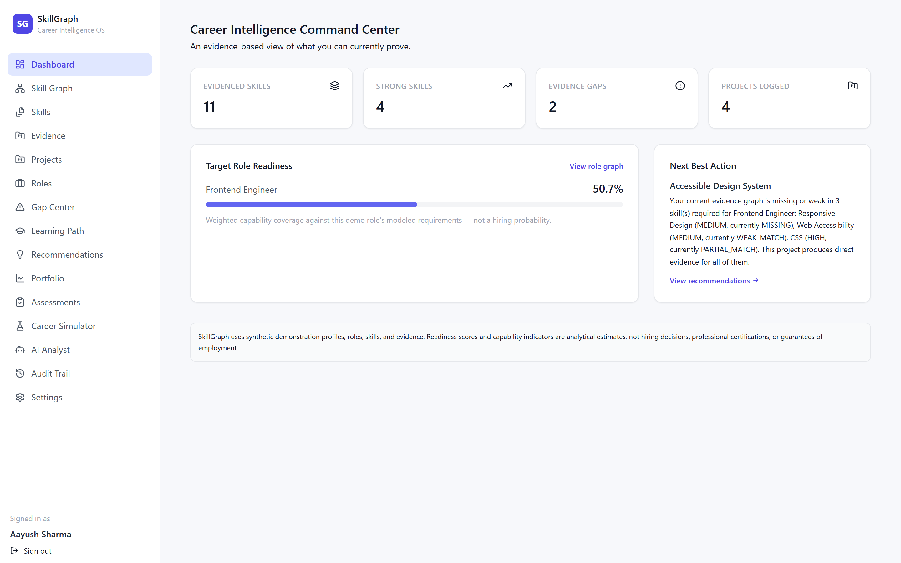

---

### 2. Interactive Skill Graph Explorer
*A force-directed React Flow DAG connecting person nodes, skill competencies, proficiency levels, and prerequisite dependency chains.*

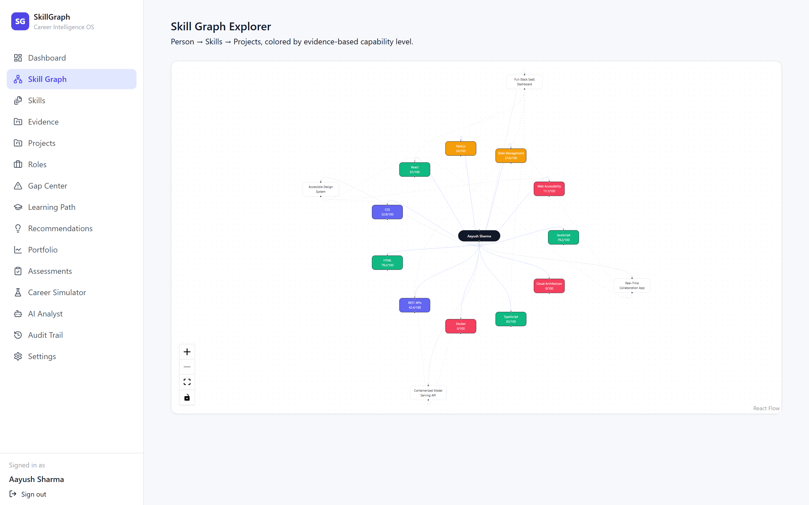

---

### 3. Role Explorer & Capability Matching
*Weighted role suitability matching against 41 industry roles, categorizing skills into critical, high, and medium priority tiers.*

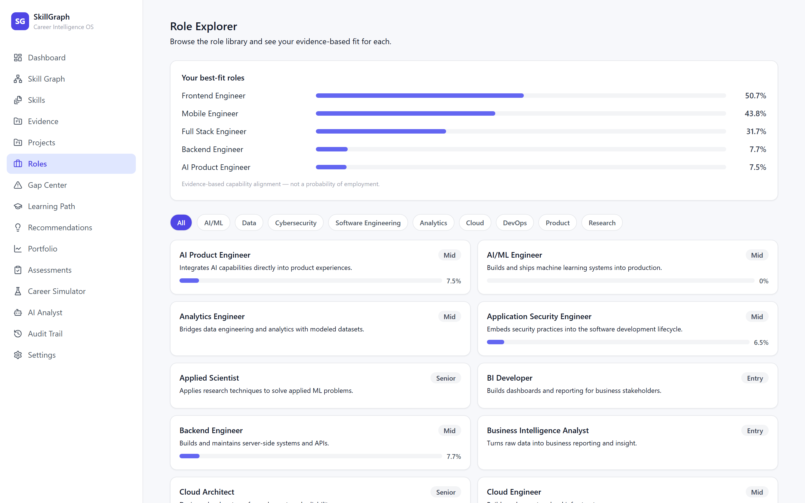

---

### 4. Dependency-Aware Gap Center
*Identifies missing prerequisites and calculates the exact critical learning path to close capability gaps for target roles.*

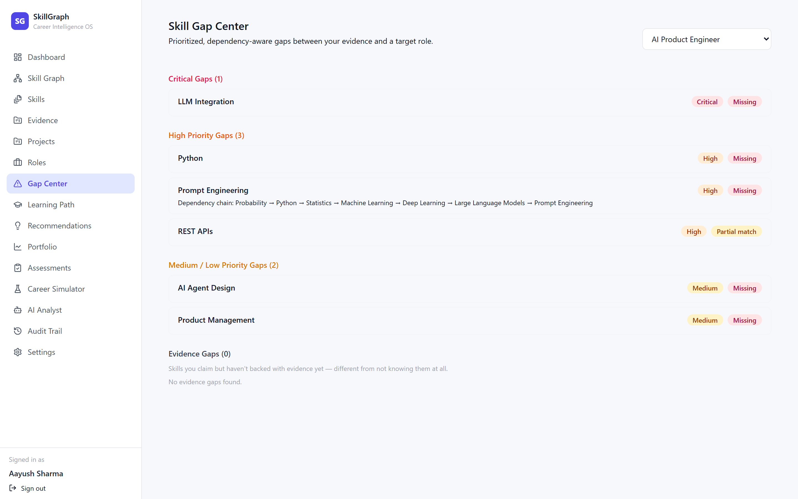

---

### 5. Career What-If Sandbox Simulator
*Simulate adding hypothetical evidence items and evaluate real-time readiness shifts before committing to learning investments.*

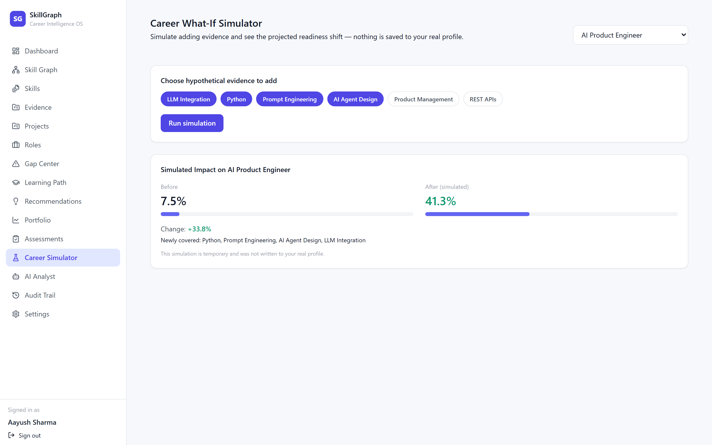

---

### 6. Grounded AI Career Analyst
*Context-grounded career advisory engine backed by prompt-injection defenses and verified evidence citations.*

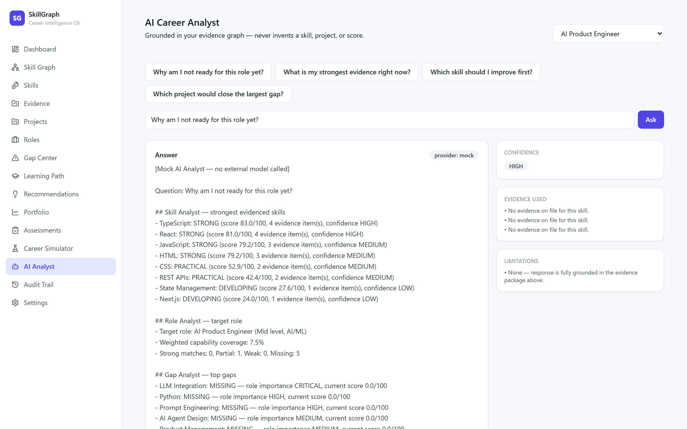

---

### 7. Evidence Verification Locker & Assessments
*Proof-of-work management tracking repository URLs, code artifacts, and verified assessment attempts.*

| Evidence Locker | Skill Assessments |
| :---: | :---: |
| 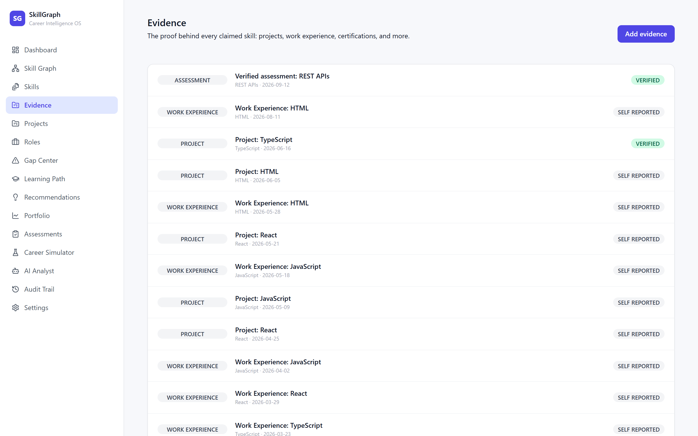 | 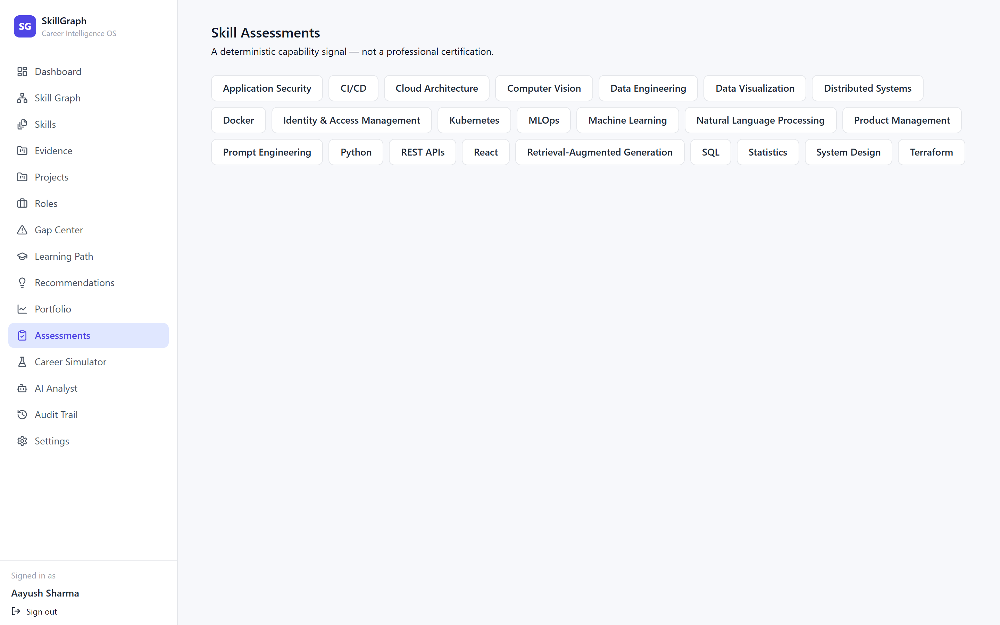 |

---

### 8. Curated Learning Pathways & Onboarding
*Ordered learning milestones and clean authentication flow with pre-populated demo personas.*

| Learning Path | Seamless Authentication |
| :---: | :---: |
| 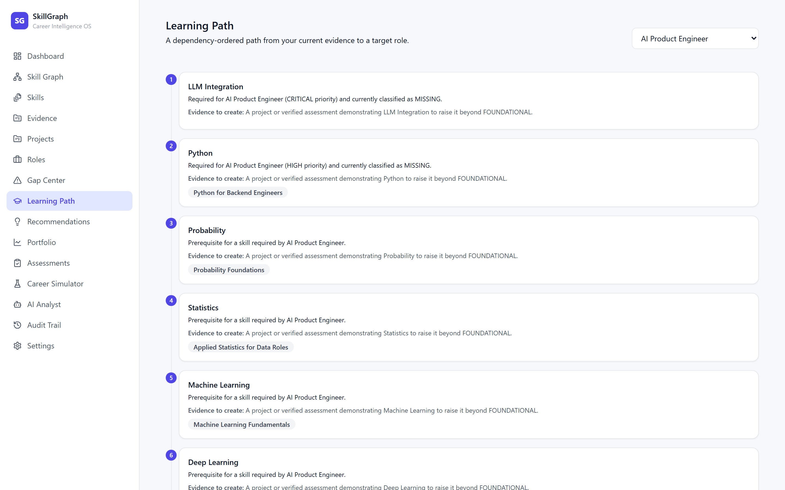 | 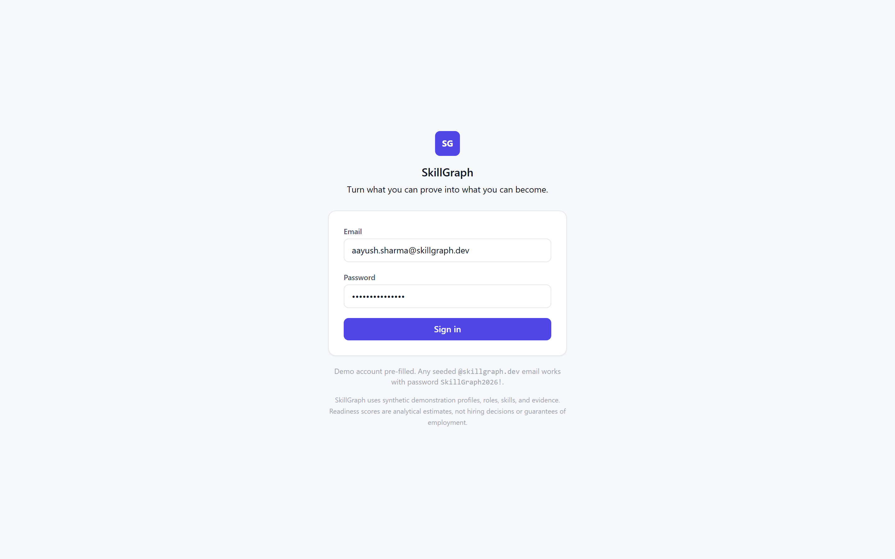 |

---

## Architecture

SkillGraph separates deterministic calculation engines from conversational AI narration to guarantee zero hallucinations and complete data provenance.

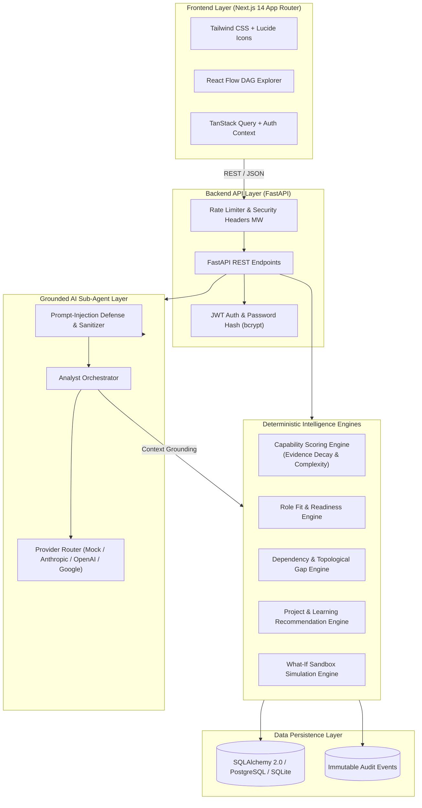

### Capability Scoring Formula

For every skill $s$ claimed or evidenced by user $u$, capability score $C(u, s) \in [0, 100]$ is computed as:

$$C(u, s) = 100 \times \left(1 - \exp\left(-\sum_{e \in E(u, s)} W_{\text{type}}(e) \cdot \lambda(t_e) \cdot \frac{C_{\text{comp}}(e)}{5} \cdot V(e)\right)\right)$$

Where:
- $W_{\text{type}}(e)$: Evidence weight (`PRODUCTION` = 1.0, `PROJECT` = 0.8, `ASSESSMENT` = 0.7, `CERTIFICATION` = 0.6, `COURSE` = 0.4).
- $\lambda(t_e) = \exp(-\ln(2) \cdot \Delta t / t_{\text{half}})$: Exponential recency decay ($t_{\text{half}} = 730\text{ days}$).
- $C_{\text{comp}}(e) \in [1, 5]$: Project architectural complexity tier.
- $V(e)$: Verification multiplier (`VERIFIED` = 1.0, `UNVERIFIED` = 0.6, `REJECTED` = 0.0).

---

## Tech Stack

| Domain | Technologies |
| :--- | :--- |
| **Frontend** | [Next.js 14](https://nextjs.org/) (App Router), [React 18](https://react.dev/), [TypeScript 5](https://www.typescriptlang.org/), [Tailwind CSS](https://tailwindcss.com/), [React Flow (@xyflow/react)](https://reactflow.dev/), [TanStack Query v5](https://tanstack.com/query), [Recharts](https://recharts.org/), [Lucide React](https://lucide.dev/) |
| **Backend** | [FastAPI](https://fastapi.tiangolo.com/), [Python 3.12](https://www.python.org/), [Pydantic v2](https://docs.pydantic.dev/), [SQLAlchemy 2.0](https://www.sqlalchemy.org/), [PyJWT](https://pyjwt.readthedocs.io/) (JWT), [passlib / bcrypt](https://passlib.readthedocs.io/) |
| **Database** | [SQLite](https://www.sqlite.org/) (zero-config default for local dev) / [PostgreSQL 16](https://www.postgresql.org/) with [psycopg2](https://www.psycopg.org/) for production |
| **AI & LLM** | Deterministic Multi-Agent Context Assembly, Multi-Provider Router ([Anthropic Claude](https://anthropic.com/), [OpenAI GPT-4o](https://openai.com/), [Google Gemini](https://ai.google.dev/), and zero-key standalone **Mock AI** provider) |
| **Testing** | [Pytest 8](https://docs.pytest.org/), [Starlette TestClient](https://www.starlette.io/testclient/), [HTTPX](https://www.python-httpx.org/), ESLint, TypeScript compiler (`tsc --noEmit`) |
| **DevOps & Infra** | [Docker](https://www.docker.com/), [Docker Compose](https://docs.docker.com/compose/), [GitHub Actions CI](https://github.com/features/actions) |

---

## Project Structure

```
SkillGraph/
├── .github/
│   └── workflows/
│       └── ci.yml               # GitHub Actions CI pipeline (test + lint + build)
├── apps/
│   ├── api/                     # FastAPI Backend Service
│   │   ├── app/
│   │   │   ├── core/            # Config, database engine, security utils
│   │   │   ├── models/          # SQLAlchemy DB models (User, Skill, Role, Evidence, etc.)
│   │   │   ├── routers/         # API routes (auth, skills, roles, gaps, ai, simulations, etc.)
│   │   │   ├── schemas/         # Pydantic v2 request/response schemas
│   │   │   ├── services/        # Intelligence engines (capability, gap, dependency, ai_analyst)
│   │   │   └── main.py          # FastAPI application entry point & middleware
│   │   ├── tests/
│   │   │   ├── unit/            # Unit tests for scoring, AI security, simulator, etc.
│   │   │   └── integration/     # End-to-end API integration test flows
│   │   ├── Dockerfile           # Production container definition for API
│   │   ├── pyproject.toml       # Pytest configuration & project metadata
│   │   └── requirements.txt     # Python production dependencies
│   └── web/                     # Next.js 14 Frontend Application
│       ├── src/
│       │   ├── app/             # App router pages (dashboard, skill-graph, roles, simulator, etc.)
│       │   ├── components/      # Reusable UI components (Sidebar, PageHeader, Charts, Graph)
│       │   ├── lib/             # API client, auth context provider, TypeScript types
│       │   └── styles/          # Tailwind CSS global styling
│       ├── public/              # Static assets & brand icons
│       ├── Dockerfile           # Standalone multi-stage Next.js Dockerfile
│       ├── package.json         # Node.js dependencies & scripts
│       ├── tailwind.config.ts   # Design tokens & color palette configuration
│       └── tsconfig.json        # Strict TypeScript compiler options
├── docs/                        # Technical specifications & architecture deep-dives
│   ├── architecture.md          # End-to-end system design
│   ├── capability-scoring.md    # Mathematical derivation of capability score
│   ├── ai-architecture.md       # Multi-agent grounding & injection defense
│   ├── gap-engine.md            # Prerequisite resolution & gap algorithms
│   ├── security.md              # Threat model, authentication & isolation
│   ├── evaluation.md            # Validation results & verification criteria
│   └── screenshots/             # High-resolution application screenshots
├── seed/                        # Synthetic Data Generation Suite
│   ├── generate_synthetic_data.py # 21 rich personas, 156 skills, 41 roles, 338 evidence records
│   ├── personas.py              # Realistic developer archetype definitions
│   └── skills_data.py           # Comprehensive skill taxonomy & prerequisite edges
├── scripts/
│   └── capture_screenshots.mjs  # Automated Chrome CDP screenshot capture script
├── .env.example                 # Root environment template
├── docker-compose.yml           # Multi-service orchestration (Web + API + Postgres)
├── LICENSE                      # MIT Open Source License
└── README.md                    # Project documentation & showcase
```

---

## Quickstart

### Prerequisites
- **Python**: `3.11` or `3.12`
- **Node.js**: `18.x` or `20.x` or `22.x`
- **npm** or **pnpm** or **yarn**

---

### Option 1: Local Development (Recommended)

#### 1. Clone the repository
```bash
git clone https://github.com/daanialmirza5/SkillGraph.git
cd SkillGraph
```

#### 2. Backend Setup
```bash
cd apps/api

# Create and activate virtual environment
python -m venv .venv
# On Windows (PowerShell):
.venv\Scripts\Activate.ps1
# On macOS / Linux:
source .venv/bin/activate

# Install dependencies
pip install -r requirements.txt

# Return to root and seed synthetic dataset
cd ../..
python -m seed.generate_synthetic_data

# Start FastAPI backend server
cd apps/api
uvicorn app.main:app --reload --port 8000
```
*Backend is now running at `http://localhost:8000` (Interactive Swagger docs at `http://localhost:8000/docs`).*

#### 3. Frontend Setup
In a new terminal:
```bash
cd apps/web

# Install dependencies
npm install

# Start Next.js development server
npm run dev
```
*Frontend is now live at `http://localhost:3000`.*

---

### Option 2: Docker Compose

To spin up the complete containerized stack (FastAPI API + Next.js Web + PostgreSQL Database):

```bash
docker compose up --build
```

---

## Demo Credentials

The platform includes 21 pre-seeded developer personas across diverse engineering disciplines:

| Role / Persona | Email | Password | Primary Focus |
| :--- | :--- | :--- | :--- |
| **Aayush Sharma** *(Pre-filled)* | `aayush.sharma@skillgraph.dev` | `SkillGraph2026!` | Frontend Engineer $\rightarrow$ AI Product Engineer |
| **Elena Rostova** | `elena.rostova@skillgraph.dev` | `SkillGraph2026!` | Backend Engineer $\rightarrow$ Distributed Systems Architect |
| **Marcus Chen** | `marcus.chen@skillgraph.dev` | `SkillGraph2026!` | Data Analyst $\rightarrow$ Senior ML Engineer |
| **Platform Administrator** | `admin@skillgraph.dev` | `SkillGraph2026!` | Global System Admin & Role Catalog Management |

*Any seeded `@skillgraph.dev` email works with password `SkillGraph2026!`.*

---

## API Reference

The FastAPI backend exposes an organized, type-safe REST API documented via OpenAPI / Swagger at `/docs`.

### Key Endpoints

| Method | Endpoint | Description | Auth Required |
| :--- | :--- | :--- | :---: |
| `POST` | `/api/auth/login` | Authenticate user & issue signed JWT access token | No |
| `GET` | `/api/profile/me` | Fetch authenticated user profile and capability summary | Yes |
| `GET` | `/api/dashboard` | Fetch aggregate metrics, category scores, and next action | Yes |
| `GET` | `/api/graph` | Retrieve node-edge DAG representation for React Flow | Yes |
| `GET` | `/api/skills` | List taxonomy skills with user-evidenced capability scores | Yes |
| `POST` | `/api/evidence` | Record new evidence artifact (repo, PR, deployment, test) | Yes |
| `GET` | `/api/roles` | List all 41 roles with calculated capability match percentages | Yes |
| `GET` | `/api/roles/{id}/fit` | Detailed breakdown of strong, partial, weak, and missing skills | Yes |
| `GET` | `/api/gaps` | Retrieve dependency-ordered critical gap paths for active goal | Yes |
| `POST` | `/api/simulations` | Run what-if sandbox simulation for hypothetical evidence | Yes |
| `POST` | `/api/ai/analyze` | Multi-agent grounded conversational analysis with citations | Yes |
| `GET` | `/api/assessments` | Fetch diagnostic assessment questions and rubric criteria | Yes |
| `POST` | `/api/assessments/submit` | Grade assessment attempt and automatically upgrade skill tier | Yes |
| `GET` | `/api/recommendations` | Curated project templates tailored to close maximum open gaps | Yes |
| `GET` | `/api/audit` | Immutable audit log of all profile and evidence mutations | Yes |
| `GET` | `/health` | System health check & active AI provider status | No |

---

## Evaluation & Testing

SkillGraph features a comprehensive test suite across backend intelligence engines, security layers, and frontend type systems.

```bash
# Run backend unit and integration test suite
cd apps/api
pytest -v

# Run frontend typecheck and production build verification
cd apps/web
npm run build
```

### Verified Test Results

```
============================= test session starts =============================
platform win32 -- Python 3.12.14, pytest-8.3.3
rootdir: apps/api
collected 38 items

apps/api/tests/integration/test_api_flow.py ........                     [ 21%]
apps/api/tests/unit/test_ai_security.py ....                            [ 31%]
apps/api/tests/unit/test_assessment_engine.py ...                       [ 39%]
apps/api/tests/unit/test_capability_scoring.py ........                 [ 60%]
apps/api/tests/unit/test_dependency_engine.py ...                       [ 68%]
apps/api/tests/unit/test_gap_engine.py .......                          [ 86%]
apps/api/tests/unit/test_recommendation_engine.py ...                   [ 94%]
apps/api/tests/unit/test_simulator.py ...                               [100%]

============================== 38 passed in 8.15s ==============================
```

- **Backend**: **38/38 passing tests** covering capability scoring decay, non-linear diminishing returns, gap dependency resolution, prompt-injection defense, assessment grading, simulation accuracy, and auth isolation.
- **Frontend**: **Zero TypeScript or Lint errors**, clean production bundle compiled across 20 dynamic and static Next.js routes.

---

## Security & Privacy

- **Data Isolation**: Multi-tenant row isolation enforced on database queries; users can never read or mutate records belonging to other personas.
- **Password Security**: Passwords hashed using industry-standard `bcrypt` with cryptographic salt.
- **Token Security**: Stateless JWTs signed with HMAC-SHA256, configurable expiry (`JWT_EXPIRE_MINUTES`), and secure header extraction.
- **Prompt Injection Defense**: User queries and portfolio inputs are treated as untrusted data blocks encapsulated within fenced delimiter blocks with strict system prompt boundaries.
- **Audit Logging**: Every evidence creation, goal modification, assessment attempt, and recommendation decision writes an append-only audit event.

---

## Roadmap

- [ ] **GitHub Webhook Ingestion**: Live automatic repository and pull request parsing to ingest real-world commit history and issue resolution into the evidence locker.
- [ ] **Temporal Capability History**: Historical time-series tracking to visualize capability score evolution over weeks and months.
- [ ] **Distributed Rate Limiter**: Redis token-bucket implementation for scalable multi-instance cluster deployments.
- [ ] **Automated Assessment Generation**: AI-generated code evaluation sandboxes running isolated test harnesses against candidate submissions.

---

## Author

**Daanial Baig**  
- **GitHub**: [@daanialmirza5](https://github.com/daanialmirza5)

---

## License

This project is licensed under the **MIT License** — see the [LICENSE](LICENSE) file for details.
